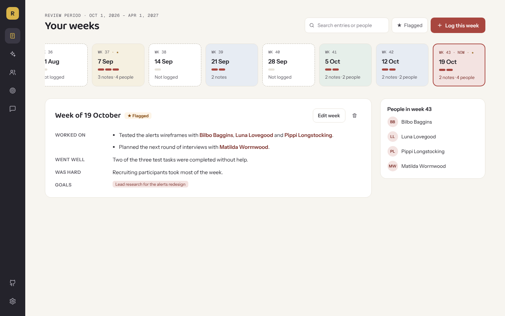
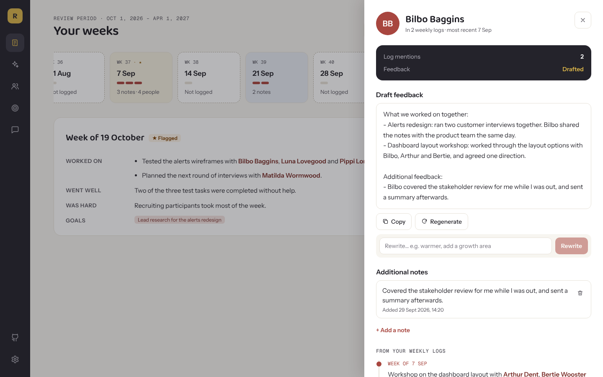
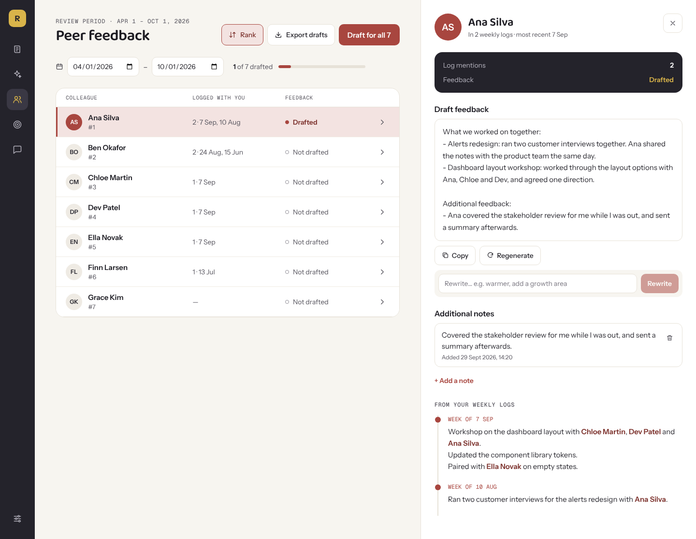
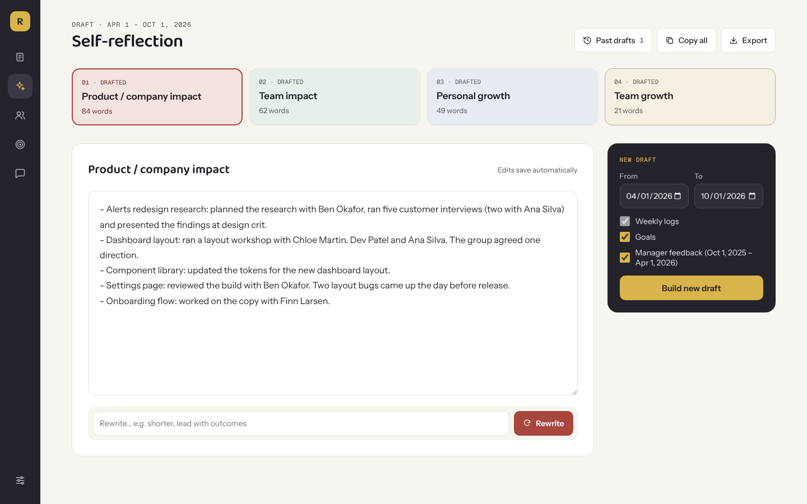
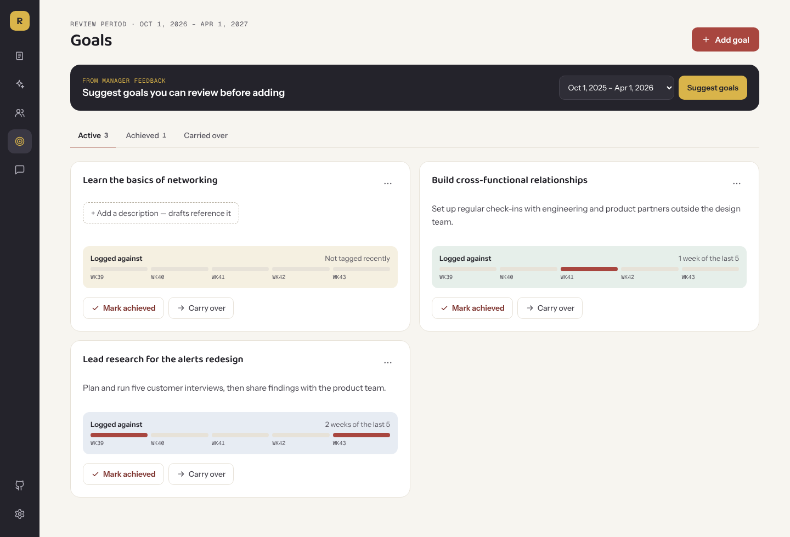
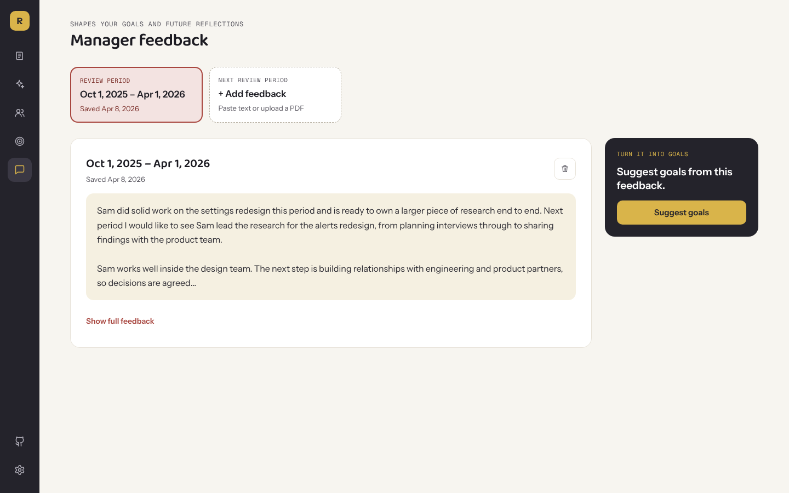
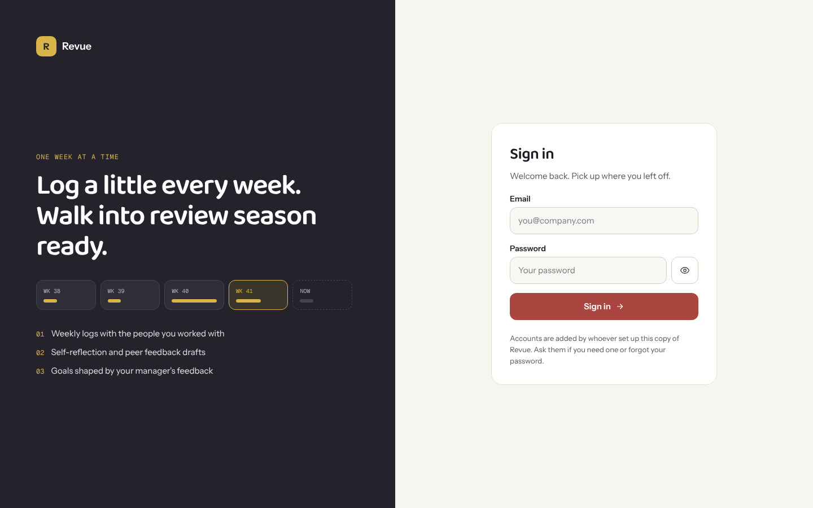

# Revue

Revue is a personal companion for performance reviews. Log what you did each week, then use those notes to draft your self-reflection and peer feedback with Claude.

- **Weekly Log**: what you worked on, what went well, what was hard. Each week is a tile; pick one to read it or fill it in. Type `@` to tag the colleagues you worked with, flag standout weeks and link entries to your goals. Search past entries or show only flagged weeks. Click a name under **People in week N** to open that colleague's feedback panel without leaving the page.
- **Self-Reflection**: drafts your self-reflection as a factual summary of your entries, sorted into four sections: the projects you worked on, who you worked with, what contributed to your growth, and what you did for the design team. Goals and manager feedback are used only to sort entries. The draft doesn't add opinions or praise your log doesn't contain. Rewrite any section on its own, with optional instructions; edits save automatically, past drafts can be reopened from the header, and you can copy or export a draft as Markdown.
- **Peer Feedback**: one row per colleague you've tagged. Open someone to see the log entries that mention them, add notes (each saved with the date and time you added it, and used in their draft and the CSV), and draft, regenerate or rewrite their feedback. Drafts list what you worked on together, then summarise your notes and comments about them, using only what you wrote. Drafts aren't saved: they stay while the tab is open and are gone when you reload or sign out, so copy or export them first. Draft for everyone at once, rank colleagues by how often they appear in your log, and export everything as CSV.
- **Manager Feedback**: paste your manager's feedback or drop in a PDF.
- **Managing**: for people who report to you. It's hidden until you turn on **Show Managing tab** in **Settings**. Add your reportees with their role and the date they started reporting to you, then log notes about each one as wins, things to improve, feedback you gave them, or things others said (tag who said it). Edit or delete notes and reportees at any time. Filter a person's notes by type and draft a factual review summary for the current or previous review period, using only that period's notes. Summaries aren't saved, so copy them first.
- **Goals**: suggest goals from manager feedback (you review them before they're added), or add your own, and track them as active, achieved or carried over. Each active goal shows which of the last five weeks you logged work against it.

Review periods run April 1 – October 1 and October 1 – April 1. The Weekly Log and Goals pages show the review period you're in, and the drafting pages default to the last finished one.

## Screenshots

All names and content below are made up.

**Weekly Log**: pick a week to read it or log it, tag colleagues with `@`, flag important weeks and link entries to goals.



Click a name under **People in week N** to open their feedback panel over the page.



**Peer Feedback**: colleagues ranked by how often they appear in your log. Open one to see their draft (what you worked on together, then your notes about them), your saved notes and the log entries that mention them.



<details>
<summary>More screenshots: Self-Reflection, Goals, Manager Feedback and login</summary>

**Self-Reflection**: a draft in four sections, each a list of what your log says. Pick a section to edit or rewrite it on its own.



**Goals**: goals suggested from manager feedback or added by hand, grouped by status.



**Manager Feedback**: paste or upload your manager's feedback for each review period, and suggest goals from it.



**Login**: sign in with the email and password you create in Supabase.



</details>

## How it works

You sign in with an email and password that you create in Supabase. The database only lets each signed-in person read and change their own records, so one copy of the app can be shared: add a colleague as a user and they get their own private space. Each person uses their own Claude API key.

| Piece | What it's for | Cost |
|---|---|---|
| [Supabase](https://supabase.com) | Stores your entries, colleagues, notes, self-reflection drafts, feedback and goals | Free plan is enough |
| [GitHub Pages](https://pages.github.com) | Hosts the site | Free |
| [Claude API](https://console.anthropic.com) | Writes the drafts | Pay per use. Drafts are short, so each one costs very little |

To share with colleagues, either add them as users on your copy (see [Adding colleagues](#adding-colleagues)) or have them set up their own copy with the steps below. [Security and privacy](#security-and-privacy) explains what each person can and can't see.

## Setup

You'll need a GitHub account, a Supabase account and an Anthropic account. To run the app on your own computer you also need [Node.js](https://nodejs.org) 22 or newer.

### 1. Put the code in your own GitHub repository

If you were sent the code as a zip file:

1. Unzip it. Check the folder includes `.github/workflows/deploy.yml`; some systems hide folders starting with a dot.
2. On GitHub, create a new, empty repository (any name, for example `revue`; don't add a README or licence).

   GitHub Pages is free for **public** repositories. For a **private** repository it needs a paid GitHub plan. With the setup below, a public repository doesn't expose your data or keys: they live in Supabase and in GitHub secrets, not in the code.
3. In a terminal, from inside the unzipped folder, push the code (put your username and repository name in the address):

   ```bash
   git init
   git add .
   git commit -m "Initial copy"
   git branch -M main
   git remote add origin https://github.com/<your-github-username>/<repository-name>.git
   git push -u origin main
   ```

The site will live at `https://<your-github-username>.github.io/<repository-name>/`. It works under any repository name, so there's nothing to change in the code. If you rename the repository later, the address changes to match.

### 2. Create the Supabase database

1. Sign in to [Supabase](https://supabase.com) and create a new project. Any name and region will do. Keep the database password somewhere safe; the app doesn't need it.
2. When the project is ready, open **SQL Editor**, start a new query, paste in the whole of [`supabase-schema.sql`](supabase-schema.sql) and click **Run**. This creates the tables the app uses.
3. Copy two values:
   - the **Project URL**, for example `https://abcdefgh.supabase.co`. Click **Connect** at the top of the dashboard, or open **Project Settings → Data API**.
   - the **publishable key**, which starts with `sb_publishable_`. Open **Project Settings → API Keys**.

   Don't use the **secret** key (it starts with `sb_secret_`). It bypasses all access rules and must never go into the site. If you do, sign-in fails with "Forbidden use of secret API key in browser". In that case delete that secret key in Supabase, because it has been exposed.

### 3. Turn off sign-ups and create your login

Only people you add should be able to have an account.

1. Open **Authentication → Sign In / Providers** (or **Authentication → Providers** on older dashboards) and turn off **Allow new users to sign up**. Leave the **Email** provider turned on.
2. Open **Authentication → Users**, click **Add user → Create new user**, enter your email and a password, tick **Auto Confirm User**, and create it.

That email and password are what you'll use on the app's login screen.

To set or change a user's password later, run this in the SQL Editor with their email and the new password:

```sql
update auth.users
set encrypted_password = extensions.crypt('new-password', extensions.gen_salt('bf'))
where email = 'colleague@example.com';
```

### 4. Run it on your computer (optional)

```bash
npm install
cp .env.example .env.local
```

Open `.env.local` and fill in the two values from step 2:

```
VITE_SUPABASE_URL=https://abcdefgh.supabase.co
VITE_SUPABASE_PUBLISHABLE_KEY=<your publishable key>
```

Then start the app:

```bash
npm run dev
```

and open the address it prints (usually `http://localhost:5173/`). Log in with the email and password from step 3. `.env.local` is ignored by git, so your values stay on your machine.

### 5. Put it online with GitHub Pages

The repository includes a workflow (`.github/workflows/deploy.yml`) that builds and publishes the site every time you push to `main`.

1. In your repository on GitHub, go to **Settings → Secrets and variables → Actions** and add two **repository secrets** with the values from step 2:
   - `VITE_SUPABASE_URL`: the Project URL
   - `VITE_SUPABASE_PUBLISHABLE_KEY`: the publishable key
2. Go to **Settings → Pages** and set **Source** to **GitHub Actions**.
3. Open the **Actions** tab. If GitHub asks you to enable workflows, enable them.
4. Push a commit to `main`, or open **Actions → Deploy to GitHub Pages → Run workflow**.

When the workflow finishes, the site is live at `https://<your-github-username>.github.io/<repository-name>/`.

These values are built into the site when it's published. If you change a secret later, run the workflow again for the change to take effect.

### 6. Add your Claude API key

The drafting features call Claude directly from your browser using your own API key.

1. Sign in to the [Anthropic Console](https://console.anthropic.com), add a payment method or credits under **Billing**, and create a key under **API Keys**.
2. Open the app, go to **Settings**, paste the key and click **Save key**.

The key is saved only in that browser. It isn't stored in Supabase or in the repository, so you'll need to enter it again on another browser or device. When you click a drafting button, your browser sends the relevant log entries straight to Anthropic with your key.

Everything except drafting works without a key: logging entries, tagging people, ranking by number of entries, managing goals and exporting.

These buttons use Claude, and each click is a charge to your Anthropic account:

| Page | Button |
|---|---|
| Self-Reflection | **Build draft** / **Build new draft** and **Rewrite** |
| Peer Feedback | **Draft for all**, and in a colleague's panel **Draft feedback**, **Regenerate** and **Rewrite** |
| Goals | **Suggest goals** |

## Updating an existing copy

Peer feedback drafts are no longer saved. Earlier versions saved them in the `drafts` table. To remove those, run this in the Supabase **SQL Editor**:

```sql
delete from drafts where type = 'peer_feedback';
```

If you set up your copy when the key was called `VITE_SUPABASE_ANON_KEY`, it keeps working: the app falls back to that name when `VITE_SUPABASE_PUBLISHABLE_KEY` isn't set.

If you set up the database before Peer Feedback had saved notes, run this once in the Supabase **SQL Editor** to add the table they're stored in:

```sql
create table colleague_notes (
  id uuid primary key default gen_random_uuid(),
  user_id uuid not null default auth.uid() references auth.users on delete cascade,
  colleague_id uuid not null references colleagues(id) on delete cascade,
  content text not null,
  created_at timestamptz default now()
);
create index colleague_notes_colleague_idx on colleague_notes (colleague_id);
alter table colleague_notes enable row level security;
create policy "own rows" on colleague_notes for all to authenticated using (auth.uid() = user_id) with check (auth.uid() = user_id);
```

Until you do, Peer Feedback shows "Couldn't load notes" in a colleague's panel.

If you set up the database before the Managing tab, run this once in the Supabase **SQL Editor** to add the tables for your reportees and their notes:

```sql
create table reportees (
  id uuid primary key default gen_random_uuid(),
  user_id uuid not null default auth.uid() references auth.users on delete cascade,
  name text not null,
  role text,
  joined_on date,
  created_at timestamptz default now()
);
create table reportee_notes (
  id uuid primary key default gen_random_uuid(),
  user_id uuid not null default auth.uid() references auth.users on delete cascade,
  reportee_id uuid not null references reportees(id) on delete cascade,
  type text not null,
  content text not null,
  said_by text[] default '{}',
  created_at timestamptz default now()
);
create index reportee_notes_reportee_idx on reportee_notes (reportee_id);
alter table reportees enable row level security;
alter table reportee_notes enable row level security;
create policy "own rows" on reportees for all to authenticated using (auth.uid() = user_id) with check (auth.uid() = user_id);
create policy "own rows" on reportee_notes for all to authenticated using (auth.uid() = user_id) with check (auth.uid() = user_id);
```

Until you do, Managing shows "Couldn't load your team".

If you added those tables before reportees had a joining date, run this once to add it:

```sql
alter table reportees add column joined_on date;
```

Until you do, adding or editing a reportee fails.

## Adding colleagues

To let a colleague use your copy, add them in Supabase under **Authentication → Users → Add user → Create new user** (tick **Auto Confirm User**) and send them the site address, their email and the password. To change their password later, use the SQL in [step 3](#3-turn-off-sign-ups-and-create-your-login).

Each person only sees their own entries, colleagues, notes, self-reflection drafts, feedback and goals. Each person adds their own Claude API key in **Settings**.

## Security and privacy

- **Sign-in is handled by Supabase.** Passwords are checked by Supabase, not by the site, and nothing secret is built into the site's code.
- **Each person can only reach their own data.** The database's row-level security only lets a signed-in user read and change rows that belong to them. Without signing in, the Supabase URL and publishable key in the site's code can't read or change anything. That's how the publishable key is designed to be used.
- **Only people you add can sign in**, as long as sign-ups are turned off (step 3).
- **The project owner can see everything.** Whoever owns the Supabase project can read every user's data in the Supabase dashboard. If colleagues share your copy, they're trusting you with their notes. If that's not right for them, they should set up their own copy.
- **Your Claude API key stays in your browser.** It's never in the site's code or the database. Anyone using your browser profile could still read it.
- **Your entries go to Anthropic when you draft.** The text of the relevant entries and notes is sent to the Claude API to write the draft.
- **Never put the secret key anywhere in the app.** It bypasses row-level security.

## Troubleshooting

**The site is blank, or shows a 404 for its files.** Check that **Settings → Pages → Source** is set to **GitHub Actions** and that the latest deploy workflow finished, then reload the page.

**I can log in, but nothing saves or loads.** Check that `supabase-schema.sql` ran without errors. Open the browser console (F12) to see the error Supabase returned.

**"Incorrect email or password."** Check the user exists under **Authentication → Users** and is confirmed, or set a new password there. If the login screen shows a different error, check the Supabase URL and publishable key (in `.env.local` locally, or in the repository secrets online, then run the deploy workflow again).

**"Forbidden use of secret API key in browser."** The key you set is the secret key, not the publishable one. Delete that secret key in Supabase (**Project Settings → API Keys**), since it has been exposed. Then put the publishable key in `VITE_SUPABASE_PUBLISHABLE_KEY` and run the deploy workflow again.

**"Add your Claude API key in Settings first."** Save your key on the **Settings** page in this browser.

**A colleague shows "Needs more info".** No weekly log entry in the selected date range tags that person, or there wasn't enough detail to write from. Open them to see the message, then tag them in an entry, add a note in their panel, or widen the date range.

## Development

```bash
npm run dev      # start the app locally
npm run build    # build into dist/
npm run preview  # serve the built app locally
npm run lint     # run ESLint
```

| Path | What's there |
|---|---|
| `src/components/` | One file per page (`WeeklyLog.jsx`, `PeerFeedback.jsx`, …) plus shared pieces |
| `src/lib/prompts.js` | The instructions sent to Claude for each feature |
| `src/lib/peerFeedback.js` | Drafting and rewriting peer feedback, shared by Peer Feedback and the Weekly Log panel. Drafts are kept in memory, never saved |
| `src/lib/claude.js` | The Claude API call, including which model is used |
| `src/lib/colleagues.js` | `@mention` parsing and saving colleagues |
| `src/lib/cycles.js` | The fixed review periods |
| `src/lib/weeks.js` | Week dates and numbers for the Weekly Log and Goals |
| `src/lib/theme.js` | Colours, fonts and the shared page layout |
| `src/lib/supabase.js` | The Supabase client |
| `supabase-schema.sql` | Database setup |
